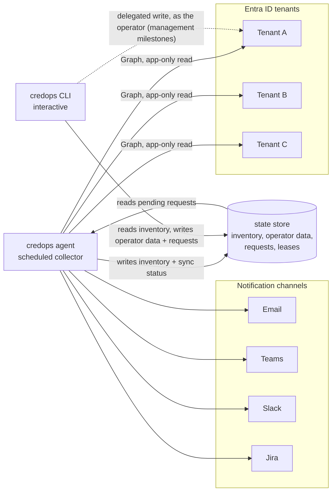

# credops — Design Document

**Status:** Draft — design phase, nothing implemented
**Author:** Alessio Chessa
**Last updated:** 2026-10-22
**License:** MIT

---

## 1. Context and scope

Entra ID app registrations authenticate using client secrets and certificates, and those
credentials expire. When one expires unnoticed, the failure is silent until it isn't: an
integration starts returning `401`, usually outside working hours, and the cause is rarely
obvious to whoever is on call.

The native experience makes this hard to get ahead of. Credential expiry is visible per
tenant, per application, in the portal. There is no single place to answer the question
*"what expires in the next 30 days, across every tenant we operate?"* — which is precisely
the question a platform engineer responsible for several tenants needs answered.

`credops` is a CLI and a scheduled agent that build and maintain a persistent, multi-tenant
inventory of Entra ID application credentials, alert before expiry through configurable
channels, and — in later milestones — perform the credential management operations that the
alerts recommend.

**In scope**

- Client secrets and certificates on **application objects** (app registrations).
- Credentials on **service principals** / enterprise applications, including **SAML signing
  certificates**.
- Multiple tenants, with per-tenant isolation.
- Thousands of application registrations per tenant.

**Out of scope for v1** — see §2 and §8 (M7) for detail: federated identity credentials, Key
Vault secrets and certificates, and credential hygiene findings beyond expiry.

---

## 2. Goals and non-goals

### Goals

| # | Goal |
|---|------|
| G1 | A single inventory of application and service principal credentials spanning all attached tenants. |
| G2 | Alert before expiry, through several channels, without producing alert fatigue. |
| G3 | **Never fail silently.** The absence of findings must be distinguishable from the absence of a working monitor. |
| G4 | Least privilege: the unattended component is read-only; anything that writes runs as a human. |
| G5 | Zero infrastructure for a single engineer on one machine, with a clean path to a team sharing one inventory. |
| G6 | Operate at a scale of thousands of applications across many tenants without being throttled into uselessness. |
| G7 | *(Later)* Perform credential management safely, as a staged lifecycle rather than a single destructive action. |

### Non-goals

- **Not a secret store.** `credops` never persists credential *values*. It stores credential
  *metadata* (identifiers, display names, validity windows).
- **Does not verify downstream consumers.** The tool cannot know where a secret is consumed,
  and will not pretend to. It tracks that a cutover is pending; the human performs it.
- **Not a server, SaaS, or network API.** There is no `credops` service to deploy, no
  listening port, and no custom authentication system to administer.
- **Federated identity credentials are not monitored.** They do not expire, so there is
  nothing for an expiry monitor to say about them. (Using federation for `credops`' *own*
  authentication is a separate matter — see §4.3.)
- **Key Vault secrets and certificates are not in v1.** Same class of problem, different
  surface; planned as future work.
- **Credential hygiene findings** beyond expiry (unusually long lifetimes, applications
  accumulating many active secrets) are future work, not v1.
- **Not a general Entra ID management tool.** The scope is credentials on applications and
  service principals, nothing wider.

---

## 3. Design overview

One binary, invoked in three ways, with **no direct communication path between the CLI and
the agent**. The state store is the contract between them.



The three invocation modes:

1. **One-shot sync** — collects once and exits. Suitable for `cron`, a systemd timer, or a
   Windows scheduled task. No daemon required.
2. **Agent** — long-lived, schedules its own collection, services requests, emits
   notifications. A convenience, never a dependency.
3. **CLI** — interactive. Reads the inventory and writes operator data. Works whether or not
   an agent is running, and whether the store is local or shared.

The governing rule: **the CLI must never require a running agent in order to answer a
question.**

---

## 4. Detailed design

### 4.1 The inventory, and why it is persistent

A stateless design — run, query Graph, alert, forget — is simpler, but it cannot support
suppressions, per-tier alert de-duplication, change history, ownership annotations, or
"what changed this week". All of those are the difference between a script and a tool, so
the inventory is persistent.

The inventory holds, per tenant: applications, service principals, their credentials
(identified by the credential's stable key identifier), owners, tags, and the history of
observations.

**Vanished objects are soft-deleted**, with a *last seen* timestamp, never removed. A
partially completed or throttled sync must never be able to masquerade as "these 300
applications were deleted".

### 4.2 Objects monitored, and ownership

Two distinct categories of service principal exist in any tenant, and conflating them
produces wrong advice:

- **Owned** — the local service principal of an application registered in this tenant. Its
  credentials are yours to rotate.
- **Foreign** — the local footprint of a third-party multi-tenant application. Its
  credentials are visible and worth monitoring, but rotating them is the publisher's job,
  not yours.

The inventory records this distinction from day one, even while the tool is monitor-only,
because the alert text differs ("rotate this" versus "contact the vendor") and because the
later management verbs must **refuse to act on foreign objects**.

**SAML signing certificates** are treated as their own case. Rotating one requires the
relying party to be updated in lockstep or single sign-on breaks for every user at once —
a materially different workflow from rotating a client secret, and not something to fold
into a generic "rotate credential" path.

### 4.3 Authentication and permissions

**One application registration per tenant.** This keeps each tenant independent, makes
adoption incremental, and means access to a tenant can be revoked cleanly at any time,
from within that tenant alone.

That single registration carries two different kinds of permission:

- **Application (app-only) permissions, read-only** — used by the unattended sync. This is
  what the agent runs as.
- **Delegated permissions** — used only by interactive management operations. A rotation
  performed from the CLI therefore executes **as the operator**, governed by their own role
  assignments, Conditional Access and PIM, and attributed to them in the audit log.

This split is deliberate and is the single most important adoption decision in this
document. Tenant-wide application *write* permission is effectively a privilege-escalation
path; no security team will grant it to an unattended daemon. Granting it to a human who
already holds it is an easy approval.

**The agent's own credentials never leave the agent's host.** The state store contains
inventory metadata only. A teammate's CLI reads the inventory and uses their own delegated
identity for writes, so a read-only teammate holds no privileged material at all.

> Federated / workload identity for `credops`' own authentication is the cleanest answer to
> "who watches the watchman", since there would then be nothing to expire. This is distinct
> from monitoring federated credentials, which is out of scope.

### 4.4 Never failing silently

Three states must be distinguishable at all times, per tenant:

1. **The sync never ran** — scheduler broken, container dead, machine asleep.
2. **The sync ran, but authentication to tenant X failed.**
3. **The sync ran cleanly and found nothing expiring.**

A tool that reports "no findings" for all three is worse than no tool, because it
manufactures false confidence. Therefore:

- Per-tenant sync status is a first-class part of the inventory.
- The CLI leads with **last successful sync, per tenant**.
- Authentication failure is a **first-class alert**, not a log line.
- A partial or throttled sync is recorded as partial and never counts as clean.

### 4.5 The self-credential alert

`credops` monitors its own credentials in every tenant, and knows which ones they are.

This alert is **generated from local inventory state**, not from a Graph call — necessarily,
because once the tool's own secret has expired it can no longer call Graph to discover that
fact. It is evaluated on every CLI invocation and at every agent start.

The alert is **displayed on every CLI run, sent to every configured channel, and cannot be
suppressed**. The only way to silence it for a tenant is to detach that tenant (§4.8).

### 4.6 Process model: lease and request channel

**The store is the contract.** The CLI and the agent never talk to each other directly.

- **Lease.** One coordination primitive: a lease held in the store elects a single active
  agent. This prevents duplicate syncs and — more importantly — duplicate notifications,
  including the inevitable case of someone leaving an agent running on their laptop as well
  as on the server.
- **Request channel.** Remote control happens through the store. A CLI on a machine that
  does *not* hold tenant credentials writes a request — *"sync tenant X now"*, *"re-send
  that alert"* — and the agent picks it up and writes the outcome back. On a machine that
  *does* hold the credentials, a sync simply runs in process.

The alternative — a local socket or an HTTP control API — only works on one machine. Making
it work across machines means authentication, TLS, and a listening service, which is a
different product. The store-mediated channel gets remote control almost for free; the cost
is polling latency measured in seconds, which is irrelevant for this workload.

### 4.7 State store and deployment modes

The store abstraction supports two modes:

- **Single machine** — an embedded, file-based store. Zero infrastructure; this is the
  default and the first-run experience.
- **Team-shared** — a networked store that several engineers' CLIs read, with one agent
  writing. Used when a team adopts the tool.

**The embedded store must never be pointed at a network share.** That is the classic
"worked fine until two people ran it at once" corruption. Shared mode requires a genuinely
networked store, and the tool should refuse the misconfiguration rather than tolerate it.

Shared mode needs no custom authentication system: access to the store is governed by the
store, and access to Entra is governed by each operator's own identity.

### 4.8 Tenant lifecycle

**Attach.** A guided onboarding flow (§4.14) produces the artifacts a tenant administrator
needs to review and approve.

**First sync is baselined silently.** Attaching a tenant with thousands of applications will
discover a large backlog of already-expired and soon-to-expire credentials — years of
accumulated neglect, surfacing at once. If the agent alerted normally on that first run it
would carpet-bomb every channel and the tool would be uninstalled the same afternoon.
Instead the first sync establishes a baseline and emits at most **one summary**
("attached; 312 credentials expire within 90 days — review with the CLI"), then alerts
normally from the next run onward.

Baselining suppresses *expiry* alerts only. The self-credential alert (§4.5) and
authentication-failure alerts (§4.4) are never swallowed by baselining or by dry-run mode —
a tool that goes quiet about its own brokenness during onboarding is exactly the failure
this design exists to prevent.

**Detach.** Detaching prompts for a choice:

- **Purge** — the tenant and its history are removed entirely.
- **Keep history** — the tenant remains listed as *detached*, with its history intact and
  readable, and can be purged or re-attached at any time.

In both cases detaching **stops all alerting for that tenant, including its otherwise
unsuppressible self-credential alert**. Otherwise detaching would not actually detach.

**Re-attach.** The gap in collection is recorded and displayed as a visible **collection
gap**, never silently stitched into a continuous timeline. "Nothing changed for three
months" must not be indistinguishable from "we were not looking for three months".

### 4.9 Notifications

**Channels.** Email, Microsoft Teams, Slack, and Jira.

**Who may notify:**

- The **agent always notifies**, unless notifications are explicitly turned off.
- A **manual sync notifies only when an explicit flag is passed** *(flag name TBD)*. With a
  terminal attached, it then asks for confirmation; with no terminal, or with an explicit
  bypass flag, it proceeds — otherwise a `cron`-only deployment with no agent could never
  alert at all.

This keeps behaviour identical regardless of deployment shape, which the alternative
(deriving notification rights from whether a lease exists) did not.

**The confirmation states blast radius**, not just a bare question:

```text
Send 847 notifications across 3 channels
  (#platform-alerts, platform@example.com, Jira PROJ)? [y/N]
```

A bare `y/N` teaches people to type `y` without reading.

**The opt-in flag runs the normal pipeline** — de-duplication and suppressions fully
respected. Re-sending regardless of prior state is a **separate, more deliberate command**.
**Suppressions are never bypassable by a flag**, because the first thing a confused operator
does is run the loud version.

**De-duplication** is per `(credential, threshold tier, channel)`. Crossing the 30-day tier
fires once, not every night. **Resolution events** are emitted too — "this was rotated,
closing" — because a monitor that never says "fixed" is not trusted.

**Jira specifically** stores the issue key and **updates or closes** the existing issue. It
must never open a second issue for the same credential; at thousands of applications, that
mistake produces a Jira graveyard within a week.

**Granularity is a per-channel setting.** Chat channels want **digests** ("14 credentials
cross the 30-day tier this week"); Jira wants **per-item** issues, because each one is a
unit of work someone has to close. These are genuinely different needs.

**Dry-run notification mode** logs exactly what would be sent and sends nothing, so
thresholds and routing can be tuned before going live.

**Kill switches** exist at three levels: global, per tenant, and per channel. The global one
is the control you reach for at 3am when something misfires.

### 4.10 Suppressions

Suppressions are **snooze-until by default**, not mute-forever. Each records **who** set it
and **why**, and **resurfaces loudly when it expires**. Permanent mutes become invisible
holes in coverage that nobody remembers creating.

Suppressions apply to a credential, an application, or a tenant. They never apply to the
self-credential alert (§4.5).

### 4.11 Configuration model

Configuration resolves over exactly **two dimensions**: **scope** (global → tenant →
application/tag → credential) and **channel**. Additional distinctions — environment,
severity, credential type — are expressed as **tags on the scope axis**, not as a third
dimension. A resolution rule that cannot be explained in one sentence is worse than a rigid
one.

**Precedence is narrow-wins**, with a short, explicitly declared list of exceptions:

- Most settings are **defaults**, refined downward by more specific scopes.
- A few settings are **ceilings**, which clamp everything beneath them and deliberately
  override narrower settings: the global kill switch, the unsuppressible self-credential
  alert, and a tenant's detached state. Precedence *among* ceilings is unresolved — see §7.

These are two different *kinds* of setting, and the distinction is part of the model rather
than emergent behaviour. If an operator cannot tell which is which, they will fight the
configuration.

**Each setting has exactly one authoritative home:**

- **Configuration file** — structural, versionable, reviewable, GitOps-friendly, lives with
  the agent: channels, credentials, schedules, global and tenant defaults.
- **State store** — operator-edited, attributed, immediately effective, editable from any
  teammate's CLI: suppressions, tags, per-application routing overrides, ownership
  annotations.

The failure mode being avoided is an operator setting an override from the CLI, the agent
reloading its file, and the change silently evaporating — or worse, not evaporating but
being silently shadowed.

**`explain` is the feature that makes layered configuration survivable.** Two forms:

- **`explain` a setting** — effective value, every layer that contributed, which one won,
  which were shadowed, and **where each layer came from** (file or store).
- **`explain` a credential** — "if this crosses the 30-day tier, here is exactly what fires,
  to which channels, and why", rendered as an outcome rather than a value.

The second is the one operators will actually use, because the real question is never "what
is this setting" but "why did I get paged / why didn't I".

### 4.12 Ownership and routing

Entra application owners are unreliable in practice: frequently empty, or pointing at
someone who left two years ago. Routing therefore resolves in order:

**local override → Entra owner → tenant default → global default**

At thousands of applications, tag-based routing is the only mechanism that keeps alert
volume meaningful.

### 4.13 CLI surface principles

- **Read-only by default.** Anything that writes is explicit.
- **Human-readable output by default, machine-readable on request**, with **meaningful exit
  codes** — so a threshold check drops into CI unchanged.
- **Leads with sync status**, per §4.4.
- **`test` for channels** — send a hello to every configured destination. This catches the
  expired Slack webhook *before* it matters.
- **Routing preview** — which applications resolve to which channels, and critically **which
  resolve to nothing at all**. Silently unrouted applications are the invisible hole in
  coverage, and nobody finds them by reading configuration.

### 4.14 Tenant onboarding flow

One registration per tenant means one administrator approval per tenant, and for an
open-source tool that is *the* adoption barrier — the difference between someone trying it
in ten minutes and closing the tab.

The onboarding flow produces exactly the artifacts an administrator needs in order to review
and approve: what is being created, which permissions are requested, why each one is needed,
and how to revoke it. The design treats this as a first-class feature rather than a
documentation problem.

### 4.15 Management lifecycle (later milestones)

Credential management is modelled as a **staged lifecycle**, not a single operation:

**add new → cut over the consumer → remove old**

`credops` cannot verify the middle step; it does not and cannot know where a secret is
consumed. What it *can* do is track that an application is in **pending cutover** and keep
reminding about the dangling old credential.

That dangling credential is the real problem in most organisations: still valid, still live,
nobody knows where it is used, so nobody dares delete it. Surfacing it is valuable even in
monitor-only mode — *"this application has four secrets, two of them left over from a
previous rotation"*.

Therefore the CLI distinguishes:

- **add** — create an additional credential, leaving existing ones untouched (overlap
  window).
- **rotate** — add, then stage the removal of a specific existing credential, with the
  pending-cutover state in between.
- **remove** — delete a specific credential, explicitly.

Supporting rules: **a new secret value is displayed once and never persisted**; destructive
operations require explicit confirmation naming the object; dry-run is available everywhere;
foreign service principals are refused (§4.2); SAML signing certificates follow their own
workflow.

Writing a new secret directly into Key Vault is the natural bridge to the Key Vault work.

### 4.16 Operating at scale

Target: thousands of applications across many tenants.

- **Throttling is expected.** Graph will push back. Sync must back off, remain resumable,
  and record partial completion honestly (§4.4).
- **Incremental and full reconciliation.** Frequent cheap incremental passes, plus a
  periodic full reconcile that catches deletions and drift. Whether Graph offers
  change-tracking for applications and service principals is an open question (§7).
- **Request shaping.** Fetch only the fields the inventory needs; avoid expensive expansions.
- Collection is staggered across tenants rather than fired simultaneously.

---

## 5. Alternatives considered

| Alternative | Why rejected |
|---|---|
| **Stateless checker** (query, alert, forget) | Simpler, but makes suppressions, per-tier de-duplication, history, ownership annotation and change reporting impossible. Those are most of the value. |
| **IPC or an HTTP control API between CLI and agent** | Only works on one machine. Extending it across machines requires authentication, TLS and a listening service — a different product. The store-mediated request channel (§4.6) gets remote control nearly free. |
| **A single multi-tenant application, consented into each tenant** | One object to maintain, but every tenant then shares one identity and one lifecycle. One registration per tenant keeps the tool usable tenant by tenant and detachable from any tenant at any time, which is the property that matters most for incremental adoption. |
| **Delegated partner-style administrative access** (GDAP) | Couples the tool to a specific tenant-relationship model that most adopters do not have, and complicates clean, tenant-local revocation. |
| **App-only write permission for the agent** | Would allow unattended rotation, but tenant-wide application write is effectively a privilege-escalation path and will not be approved for an unattended daemon. Delegated write as the operator (§4.3) is both safer and far easier to adopt. |
| **Mute-forever suppressions** | Simpler, but accumulates invisible coverage holes nobody remembers creating. Snooze-until with attribution and expiry resurfacing instead (§4.10). |
| **Per-item alerts on every channel** | Unusable at thousands of applications; chat channels become noise and get muted. Digest for chat, per-item for Jira (§4.9). |
| **Deriving notification rights from lease ownership** | Behaviour would change silently with deployment shape, which is exactly the kind of thing that confuses people later. Explicit opt-in flag instead (§4.9). |
| **Name: `azcredsctl`** | The `az` prefix collides with the Azure CLI's own command name and borrows Microsoft's product naming. The same objection applies to an `entra` prefix. |
| **Name: `credctl`** | Checked 2026-10-22: the `credctl` GitHub organisation is active and holds `credctl/credctl` — a Go credential-management CLI — plus `credctl/homebrew-tap`. Same name, same domain, same language, distribution channel already claimed. |

---

## 6. Cross-cutting concerns

### Security and privacy

- **No credential values are ever persisted.** Metadata only.
- **Least privilege:** the unattended path is read-only; writes run as a human with their own
  roles, Conditional Access and PIM applied, and are attributed to them.
- **Credentials stay on the agent host.** The shared store holds inventory metadata only, so
  a read-only teammate holds no privileged material.
- **Supply-chain hygiene matters more than usual here.** This is an open-source tool asking
  for tenant-wide read access to an identity system. Signed releases, verifiable checksums,
  a minimal dependency surface, and permission documentation that an administrator can
  actually audit are adoption requirements, not polish.
- **Detach must really detach**, including purging history on request (§4.8).

### Scalability

See §4.16. The binding constraints are Graph throttling and notification volume, not local
computation.

### Reliability and observability

- Sync status per tenant is first-class, and silence is never "all clear" (§4.4).
- Partial syncs are recorded as partial.
- Soft-delete with *last seen* prevents a throttled sync from inventing mass deletions.
- A single active agent is elected by lease (§4.6).
- Channel `test` and routing preview (§4.13) surface broken delivery paths before they
  matter.
- Dry-run notification mode (§4.9) makes the blast radius inspectable before going live.

### Testing

The notification pipeline, the configuration resolver, and the sync-status state machine are
the three areas where defects are most costly and least visible. Each needs to be testable
without a live tenant.

---

## 7. Open questions

1. **Exact Graph permission scopes.** The design requires a least-privilege *read* set
   covering applications, service principals and owners, plus a delegated set for writes.
   The precise scope names must be confirmed against current Graph documentation rather than
   assumed.
2. **Change tracking.** Whether Microsoft Graph offers delta / change-tracking for
   applications and service principals — and with what caveats — needs verification. It
   materially affects §4.16.
3. **Teams delivery mechanism.** Which incoming-webhook mechanism is current for Teams needs
   checking before implementation; do not assume.
4. **Notification opt-in flag name.** TBD.
5. **Store engines.** Which embedded and which networked store to support — deliberately not
   decided in this document.
6. **Milestone 2 placement.** Whether the onboarding flow should precede or follow additional
   channels (§8) is a proposal, not a decision.
7. **Shared-mode configuration distribution.** In team-shared deployments, how the structural
   configuration file reaches the agent host is unresolved.
8. **Precedence among ceilings (§4.11).** The global kill switch says "send nothing"; the
   self-credential alert says "send to every channel, unsuppressibly". These directly
   contradict each other and no winner has been chosen. CLI display of the self-credential
   alert presumably survives either way, but the delivery question is open.

---

## 8. Milestones

### M1 — MVP

1. Attach tenants and authenticate (app-only, read-only).
2. Sync applications and service principals into the inventory, **with sync-status tracking**
   (§4.4) and owned/foreign classification (§4.2).
3. List and threshold-check commands, human and machine-readable output, meaningful exit
   codes.
4. **One** notification channel end-to-end, with per-tier de-duplication.
5. Suppressions with expiry, plus the unsuppressible self-credential check.
6. **Silent first-sync baselining and dry-run notification mode.**

> Items 1–5 are the minimum useful tool. Item 6 is not optional *because* item 4 ships a live
> channel: without baselining and dry-run, the first tenant attached to v0.1 gets
> carpet-bombed (§4.8).

### M2 — Onboarding *(placement proposed, not decided)*

Guided tenant onboarding flow (§4.14), to remove the primary adoption barrier.

### M3 — Channels

Remaining channels, Jira issue lifecycle (update/close, never duplicate), digest versus
per-item granularity, resolution events.

### M4 — Routing and configuration

Tags, ownership routing, the layered configuration model, `explain`, channel `test`, routing
preview including unrouted applications.

### M5 — Shared mode

Networked store, lease-based single active agent, store-mediated request channel.

### M6 — Management

Add, rotate and remove as a staged lifecycle with pending-cutover tracking, delegated write,
confirmation and dry-run, foreign service principal refusal, SAML signing certificate
workflow.

### M7 — Key Vault and hygiene

Key Vault secrets and certificates; hygiene findings beyond expiry; rotate-into-vault.
